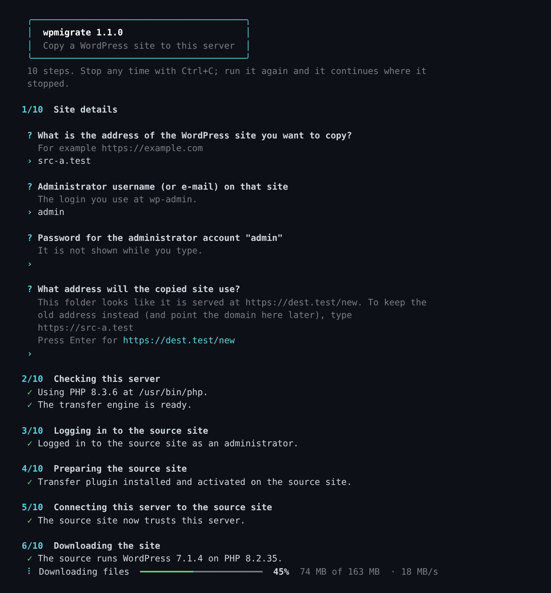

# wpmigrate

Copies a WordPress site onto the server you run it on. You only need the
address of the old site and an administrator login for it. It uses
[Reprint](https://wordpress.org/plugins/reprint/) to do the transfer.

## Run it

Open SSH on the server, and run this one line. Change the folder to the one the
site should live in:

```
cd ~/www/example.com/public_html && curl -fsSLo ~/wpmigrate.pyz https://raw.githubusercontent.com/nikoh663/WPSGMIG/main/dist/wpmigrate.pyz && python3 ~/wpmigrate.pyz
```

It downloads the tool to your home folder (not the site folder), then starts it.
If `curl` is missing, use `wget -qO ~/wpmigrate.pyz` with the same address.



Then answer the questions. You can press Ctrl+C at any time, or lose the SSH
connection, and run the same command again later: it continues where it stopped.

It needs Python 3.10 or newer and PHP 7.4 or newer on the command line (8.2 or
newer is recommended) with the curl, hash, json, mbstring, mysqli, openssl, PDO, Phar and zlib
extensions (all common on hosting). It runs as your normal hosting user and does not need root.

## What it does

1. Asks for the old site's address, the admin username and password, and the
   address the copy will use. If you start it in a folder such as
   `example.com/public_html/new`, it suggests `https://example.com/new`.
   Otherwise it suggests the same address as the old site.
2. Checks this server: Python, a suitable PHP, disk space, and Reprint. If no
   `reprint.phar` is given with `--reprint-phar`, it downloads the official one.
3. Logs in to the old site's wp-admin like a browser would. It stops after 3
   wrong tries so the account is not locked.
4. Installs and activates the Reprint plugin on the old site, unless it is
   already there.
5. Authorizes this server on the old site with a Migration Token, or with a
   connection token where the site uses those.
6. Measures the site and shows the size of the files and of the database
   separately, then downloads both. It resumes if it is interrupted.
   - Backup archives made by All-in-One WP Migration, UpdraftPlus, Duplicator,
     BackWPup, WPvivid, BackupBuddy and similar plugins are never copied, and
     neither are cache and log files. The transfer engine always skips them and
     has no way to bring them along. The tool tells you which backup plugins it
     can see and roughly how much space these take on the old site (from the
     site's own Site Health numbers), so you can download a backup from the
     plugin's screen if you need one.
   - It also looks for other leftover backups: backup folders, database dumps
     and large archives next to WordPress. It lists them with their sizes and
     asks whether to copy none of them (the default), all of them, or the
     ones you pick by number (`--skip-backups yes|no` answers none or all in
     advance). Nothing is deleted on the old site.
7. Sets up the destination:
   - which folder (press Enter for the current one, or type a subfolder such as
     `blog`);
   - what to do with a WordPress site already in that folder (remove it, keep it
     at `old.<domain>`, or cancel);
   - the database details;
   - what to do with files that are not part of WordPress: move them to a
     backup folder, to the kept old site's folder, or to a folder you name;
     remove them; or leave them. Files the host puts there, such as
     `.well-known`, `cgi-bin` and `Default.html`, are left alone.
8. Imports the database, puts the files in place, writes `wp-config.php`, and
   checks that WordPress starts.
9. Removes this server's access and the plugin from the old site (the plugin
   only if this tool installed it).
10. Prints a summary of what to check next, and where the time went.

If any step on the old site fails (steps 3 to 5), for example because the host
does not allow installing plugins, or there is a CAPTCHA or two-factor login, the
tool prints the Migration Token and click-by-click steps for you to do in a
browser. It waits for you, then continues. `--manual` goes straight to that.

It never tries to get around a CAPTCHA, two-factor login or bot check.

## Options

No options are needed. They exist for scripted runs, or to answer a question
in advance. Run `python3 wpmigrate.pyz --help` for the full list. Every option
can also be set as an environment variable, for example `WPMIGRATE_SOURCE` or
`WPMIGRATE_DB_NAME`.

Passwords are never options, so they never show up in the process list.
Type them when asked, or set `WPMIGRATE_ADMIN_PASSWORD` and
`WPMIGRATE_DB_PASSWORD`. The tool removes those from its environment as soon as
it has read them.

Example of a run with no questions:

```
WPMIGRATE_ADMIN_PASSWORD=... WPMIGRATE_DB_PASSWORD=... python3 ~/wpmigrate.pyz \
  --non-interactive --source https://example.com --user admin \
  --db-name site_db --db-user site_user --replace-tables
```

## Exit codes

| Code | Meaning |
|------|---------|
| 0 | Success |
| 1 | Other error |
| 10 | Login to the old site failed |
| 11 | The old site has not authorized this server yet |
| 12 | The download failed (run again to continue) |
| 13 | Setting up the destination failed |
| 14 | Cancelled (Ctrl+C or a "cancel" answer) |
| 15 | This server is missing something (Python or PHP version, a PHP extension, Reprint) |
| 16 | Another run for the same site is still going |

## Where things are kept

Everything the tool keeps is in `~/.wpmigrate/sites/<site>/` (folders 0700,
files 0600), never in the website folder: saved progress (`state.json`), the
log, Reprint's working folder, the signing key, the download, and backups. The
tool writes no PHP files of its own into the website folder.

- **Passwords:** never written to the state file or the log, and removed from
  all log and error output.
- **After a successful copy:** the database dump and the login cookies are
  deleted, unless you pass `--keep-downloads`.
- **After the old site is tidied up:** Reprint's working folder and the
  download are deleted too, because Reprint's own state holds the database
  password in plain text.
- **Destructive steps:** removing or moving an existing site, or replacing
  database tables, each need their own confirmation. They are recorded so that a
  rerun never repeats one.
- **Running twice:** a lock stops two runs on the same site at once.

## How the files land in the folder (layout trade-off)

The spec asked for the layout to be chosen by testing. Three options were tried
on a test server set up like shared hosting: Apache with
`SymLinksIfOwnerMatch`, running as a different user than the site owner.

| Layout | Result | Trade-off |
|--------|--------|-----------|
| Symlinks into the download (Reprint `flat-docroot` default) | **Failed: every page answered 403.** | The download lives in the private 0700 folder, so the web server cannot follow the links. Making it readable would expose the SQL dump and the key. Removed from the tool. |
| Copy (`--file-layout copy`) | Works | Needs twice the disk space while it runs, and is slower. |
| Move (default) | Works | Fast and needs no extra space. The download is used up, so a fresh copy means downloading again (Reprint's state is deleted at the end anyway). |

The tool builds the standard layout with Reprint's `flat-docroot` in the
private folder. It then moves the real files (or copies them) into the website
folder, and sets folders to 0755 and files to 0644.

## Building from source

```
python3 tools/build_pyz.py      # writes dist/wpmigrate.pyz (commit it: the run command downloads it)
python3 -m unittest discover -s tests -t .
```

Only the Python standard library is used. The engine (`wpmigrate/engine`) has no
global state and never reads input itself. Questions go through a prompter
interface, progress goes out as events, and commands and files go through one
system interface. That means a web front end can drive it the same way the
command-line one (`wpmigrate/cli.py`) does.

`e2e/` holds the end-to-end test setup: Docker source sites, a destination web
server and databases, a pseudo-terminal driver, and the recorded output of each
scenario in `e2e/results/`. The driver's `run` steps act as the person or host in
a scenario, through a shell, and are not part of the tool.
